# 第一篇 底座：算力与智算集群

## 篇首

一位做了八年数据库与 Kubernetes 运维的工程师，第一次接手 GPU 集群时的普遍感受是：熟悉的手段全部还在，但有三条直觉不灵了。

第一条是冗余直觉。过去一个实例坏了，流量自动切走，运维只需要补一台。在智算集群里，一个八卡张量并行的推理副本缺一张卡就整组不可用，补上来的新机器还要花十几分钟装权重才能接管。第二条是可替换直觉。GPU 从来不是同质资源：显存容量、NVLink 域、与邻居的交换机跳数，都决定一台机器能不能凑进同一个任务。第三条是指标直觉。控制台上的 GPU 利用率 100%，可能意味着算力只跑出了三成。

本篇处理的就是这三条直觉背后的物理与系统层：机器怎么交付、网络与存储怎么验证、驱动与运行时怎么治理、卡坏了怎么办。云上产品形态以阿里云为例（智能计算灵骏、高性能网络、文件存储 CPFS、容器服务 ACK 的灵骏节点池），但每一章末尾都给出脱离该环境的等价做法——底座层的知识迁移性最强，因为硬件与内核不会因为厂商而改变行为。

下面集中给出本篇用到的名称，按 1.2 的分层归类：贯穿全篇的概念放在最前，其余按物理硬件、系统软件、平台服务自下而上排列，最后一组是本篇反复用到的度量口径；模型层与应用层的名称分别见第三篇与第五篇的表。同一组内按首次出现的小节排序，每条只解释它在本书中的用法，不给通用定义；同一事物在不同厂商或不同栈上的叫法差异，在正文出现处就地说明。

| 层次 | 名称 | 在本篇中的用法 | 详见 |
| --- | --- | --- | --- |
| 贯穿全篇 | 并行组 | 共同承载一份模型的一组卡或一批机器，是故障影响面的基本单位 | 1.1 |
| 贯穿全篇 | 智算栈分层 | 物理硬件、系统软件、平台服务、模型、应用；跨层故障要先确定落在哪一层，才选得对工具 | 1.2 |
| 物理硬件 | NVLink 域 | 一台机器内以高速互联直连的卡集合，决定哪些卡能凑进同一个任务 | 1.1 |
| 物理硬件 | 固件基线 | 驱动、VBIOS、BMC、网卡与交换机固件的版本组合，交付前一次性固化 | 2.2 |
| 物理硬件 | 烤机 | burn-in，持续负载下的稳定性筛选，筛的是同批机器的性能方差而不是单机峰值 | 2.3 |
| 物理硬件 | 总线带宽 | 把集合通信的数据量按通信模式折算到单卡链路的等效带宽，规模扫描看它而不是看算法带宽 | 2.4 |
| 物理硬件 | 长稳 | 真实负载连续运行一到三天，记录中断次数、恢复耗时与吞吐衰减 | 2.5 |
| 物理硬件 | 故障注入 | 主动制造故障以验证恢复能力，验收的最后一步，验证的不是性能而是回退路径 | 2.5 |
| 物理硬件 | 参数面网络 | 承载集合通信的网络平面，与业务流量隔离；特点是既不报错也不告警，只是变慢 | 3.1 |
| 物理硬件 | RDMA / RoCE | 绕过内核与 CPU 的远程直接内存访问；RoCE 是在以太网上承载它的协议 | 3.1 |
| 物理硬件 | PFC / ECN | 无损调优的两个旋钮：逐跳反压与拥塞标记，网卡与交换机两侧必须一致 | 3.1 |
| 物理硬件 | 拥塞塌陷 | 反压沿拓扑层层传导后整网吞吐骤降，现场表现是一批不相关的任务同时变慢 | 3.1 |
| 物理硬件 | GPUDirect RDMA | 网卡直读显存、绕过主机内存拷贝，是集合通信带宽达标的前提 | 3.2 |
| 物理硬件 | 慢节点 | 自身不报错、只表现为拖慢整组的节点；一次 all-reduce 的耗时由最慢的一条路径决定，它是离群机排查的起点 | 3.3 |
| 物理硬件 | 离群机 | 阶段耗时显著偏离同组其他节点的那一台，是慢节点定位的入口 | 3.3 |
| 物理硬件 | 元数据 | 文件名到数据块位置的索引信息，其 QPS 常先于吞吐成为存储瓶颈 | 3.4 |
| 物理硬件 | Xid | 驱动上报的 GPU 错误编号，分类处置的入口 | 5.1 |
| 物理硬件 | ECC | 显存纠错码；可纠正错误看趋势，不可纠正错误必须隔离 | 5.1 |
| 物理硬件 | 页面退役 | 显存坏页被移出可用集合的动作，单条无需处理，反复出现是换件依据 | 5.1 |
| 系统软件 | 支持集 | 经过组合验证的版本集合，节点池只在支持集内变更 | 1.2 |
| 系统软件 | 静默降级 | 服务全部正常启动而性能已经下降的状态，只能靠变更后复测发现 | 4.1 |
| 系统软件 | 节点池 | 硬件与软件版本一致的一组机器，是灰度升级与故障隔离的最小操作单位 | 4.3 |
| 平台服务 | 组调度 | 一组任务要么同时拿到资源启动、要么整体等待，避免部分启动后空占卡 | 1.4 |
| 平台服务 | 检查点 | 训练中间状态的落盘快照，决定故障后能回退到哪里与恢复要多久 | 3.5 |
| 平台服务 | 摘除 | 使节点不再接收新任务并迁走存量负载，是处置动作而不是诊断手段 | 5.2 |
| 平台服务 | 装箱率 | 已分配资源占总量之比；装箱率高不等于新任务起得来 | 5.4 |
| 度量口径 | MFU | Model FLOPs Utilization，实际达到的浮点吞吐与硬件理论峰值之比，训练侧效率的主指标 | 1.3 |
| 度量口径 | Tokens/s/GPU | 每卡每秒产出的 token 数，推理侧吞吐的主指标，必须与首 Token 时延一起看 | 1.3 |
| 度量口径 | 单位请求成本 | 卡时、存储、网络与 token 四要素折算到一次请求的成本 | 1.3 |
| 度量口径 | GPU 利用率 | `nvidia-smi` 只统计采样周期内是否有内核在运行，不代表算力被用满 | 1.3 |

## 第 1 章 智算栈的认知重排

### 1.1 传统在线服务的四层模型在 GPU 集群上为什么不成立

过去二十年运维的知识结构，建立在四个假设上：服务是无状态的、实例是可替换的、故障域是可控的、系统指标能代表用户体验。四条在大模型场景中被逐条削弱。

无状态并不成立。推理副本看似可以随意重启，但显存里的 KV Cache 池、已完成的权重加载与图编译（CUDA Graph 捕获）都是启动成本。一次滚动更新的实际中断时间由权重加载与预热决定，而不是由进程启动决定，这使"重启即恢复"的经典操作在分钟级时延目标面前失效。

可替换也不成立。训练任务的调度约束是拓扑与显存，而不是 CPU 与内存的核数。八卡任务要求同机或同 NVLink 域内的卡同时可用，调度器把一台机器上的七张空闲卡与另一台上的一张卡拼起来毫无意义——资源数量看起来够，任务永远起不来。这就是集群装箱率很高而队列仍然排长队的典型成因。

故障域更集中。一张卡故障影响的是一个并行组，而不是一份无状态副本；一块光模块性能劣化影响的是整批机器的通信效率。故障影响面从"实例"上移到"并行组"与"网络域"，值班定位的第一问也从"哪个实例挂了"变成"哪一个并行组被拖慢了"。

指标不再代表体验。传统服务的 QPS 与响应时间是用户可感知的量，而模型服务里同样的请求可能生成 20 个 token 或 2000 个 token，成本与时延相差两个数量级。用 QPS 做容量规划在大模型上会系统性低估需求。

| 旧假设 | 在模型服务上的失效表现 | 需要替换的做法 |
| --- | --- | --- |
| 服务无状态，重启即恢复 | 显存缓存、权重加载与图编译构成启动成本，滚动更新窗口由加载耗时决定 | 把加载与预热时间纳入发布指标，就绪判定等真实预热完成 |
| 实例可替换，凑够数量即可 | 并行组要求同域连续的显存与互联，卡数够而任务起不来 | 按并行组预留资源，任务规格归一后再看装箱率 |
| 故障域在实例级 | 一张卡影响一个并行组，一条链路影响一批机器 | 故障影响面按并行组与网络域评估 |
| 系统指标代表体验 | QPS 与响应时间不刻画 token 消耗与生成质量 | 用首 Token 时延、逐 Token 间隔、每卡吞吐与单位请求成本 |

### 1.2 智算栈分层：物理硬件、系统软件、平台服务、模型、应用

业界对 AI 基础设施的划分口径不一，但落到运维视角可以稳定地分为五层，每层的故障形态与责任团队不同。

物理硬件层是 GPU 服务器、交换机、光模块、供电与制冷。这一层的问题是"设备是否健康、性能是否达标"，处置手段是验收、隔离、换件，运维对象是机器本身。系统软件层包括内核、GPU 驱动、加速计算栈（CUDA 及国产等价运行时）、容器运行时与设备插件。这一层的问题是"版本组合是否可用"，处置手段是基线与灰度升级。平台服务层是调度与编排：集群、队列、配额、镜像与数据分发、训练与推理平台。模型层是权重、微调产物、评测结果与版本关系。应用层是推理接口、检索增强与智能体。

这个分层对读者的实际价值只有一句话：任何一次跨层故障，都要先确定它落在哪一层，才能选对诊断工具。同一现象——任务变慢——在物理层是慢节点，在系统软件层是驱动不匹配，在平台层是碎片与排队，在模型层是并行策略不当。诊断的差别不在思路上，而在你能否把现象约束到一层。

| 层次 | 运维对象 | 典型故障形态 | 主要抓手 |
| --- | --- | --- | --- |
| 物理硬件 | 服务器、交换机、光模块、供电制冷 | 掉卡、链路误码、性能离群 | 验收、监控趋势、隔离换件 |
| 系统软件 | 内核、驱动、加速运行时、容器与设备插件 | 版本组合不兼容、静默降级 | 基线、支持集、变更复测 |
| 平台服务 | 集群、队列、分发、训练与推理平台 | 排队、碎片、加载慢、伸缩失灵 | 调度策略、配额、发布流程 |
| 模型 | 权重、微调产物、评测结果、版本关系 | 效果漂移、版本错配、回滚失效 | 制品治理、评测门禁、灰度 |
| 应用 | 接口、检索、智能体 | 成本突增、失控循环、注入与外泄 | 护栏、预算、轨迹审计 |

### 1.3 三个新北极星指标：MFU、Tokens/s/GPU、单位请求成本

MFU（Model FLOPs Utilization，模型算力利用率）衡量的是实际达到的浮点吞吐与硬件理论峰值之比，是训练侧最重要的单一指标。它和 GPU 利用率不是一回事：`nvidia-smi` 报告的利用率只统计采样周期内是否有内核在运行，一个访存受限、算力空转的内核同样显示 100%。判断效率要看 MFU、SM 活跃比例与张量管线占用，工具在 Nsight Systems 与 DCGM 的专业指标里。MFU 的合理区间随模型结构、并行策略与精度变化很大，公开讨论的稠密模型经验值不能作为你的验收线，必须用自己的模型与配置实测基线后再做趋势管理。

推理侧的对应指标是每 GPU 每秒生成 token 数，以及同时满足首 token 时延与逐 token 间隔要求的有效吞吐。这两个指标才真正刻画"这台机器值不值"。第四篇会给出完整的测算方法，本篇只需要建立一个认识：容量语言从 QPS 换成了 token 与显存的组合。

单位请求成本是前两个指标的货币化表达。训练按卡时与存储计量，推理按 token 计量，两者都能直接落到账单。它是全书唯一一条从运维直通业务决策的通道，也是运维工程师在新领域最容易被看见的贡献。

三组指标的对应关系如下，右列的数据来源决定了值班时该看哪一块盘。

| 关注点 | 传统在线服务 | 模型服务 | 数据来源 |
| --- | --- | --- | --- |
| 吞吐 | QPS | 每 GPU 每秒生成 token 数、满足时延目标的有效吞吐 | 引擎侧指标接口 |
| 时延 | 平均响应时间与高分位数 | 首 Token 时延与逐 Token 间隔，必须标注测量位置 | 网关与引擎两侧分别采集 |
| 资源效率 | CPU 与内存利用率 | 训练看算力利用率与通信占比，推理看显存与缓存占用 | 设备侧指标加引擎侧指标 |
| 容量约束 | 连接数、线程池 | 显存上限换算出的并发上限 | 检查点前的容量实测曲线 |
| 成本 | 机器时按业务分摊 | 卡时、存储、网络与 token 四要素合成单位请求成本 | 账单与用量标签 |
| 质量 | 无（由业务侧判断） | 评测得分、拒答率、模式合规率、人工点踩率 | 评测流水线与线上实验 |

### 1.4 全书地图：一次请求与一次训练任务各自走过的路径

一次推理请求走过：接入与网关 → 路由与前缀缓存判定 → 调度队列 → 批处理组批 → 预填充与解码 → 显存中的 KV 分配与回收 → 流式返回 → 日志与指标落盘 → 成本归因。这条线是第四篇的主干，第五篇在此之上叠加智能体的多步循环。

一次训练任务走过：数据集与语料准备 → 提交到队列并以组调度方式整体调度 → 多机通信组建立 → 前向、反向与优化器步骤 → 检查点异步落盘 → 故障后从最近检查点恢复 → 评测与准入 → 注册为可部署工件。这条线是第三篇的主干。

两条线共同踩在同一片地上：健康且拓扑可知的机器、足够快的网络与存储、版本一致的驱动与运行时。这就是本篇从最底层讲起的原因。

图 1-1　全书两条主线：一次请求与一次训练任务各自走过的路径

**迁出云上环境**：本篇涉及的分层与指标完全与厂商无关。自建 IDC 或裸金属租卡环境下，同样按"物理—系统软件—平台—模型—应用"五层组织资产台账与值班职责，只是把云上托管能力（节点自愈、监控采集、配额）换成自建等价组件：DCGM 加 Prometheus 采集、Node Problem Detector 做异常检测、Volcano 或 Kueue 做队列与组调度。

**本章自查**：能否用一句话说清你所在环境里 MFU 或每 GPU token 吞吐的当前基线；能否在故障发生后 5 分钟内判断它落在五层中的哪一层。两个问题答不出，本篇剩下的内容都值得细读。

## 第 2 章 节点交付与验收

批量到货的三十台八卡服务器，其中一定有几台是坏的。差别只在于你在验收时找到它们，还是在生产任务里被它们找到。这一章给出多数团队实际在用的五步验收流程。

图 2-1　节点交付验收五步流程与三个不合格出口

### 2.1 硬件一致性与健康性核对

逐台核对的清单包括：GPU 型号、数量、显存容量与标称带宽，NVLink 连接关系；CPU 型号、核数、主频与内存频率通道数；NVMe 型号、容量、SMART 状态与已写入量；网卡型号与固件版本；光模块类型、序列号与收发光功率；BIOS 与 BMC 配置项（NUMA 拓扑、Above 4G Decoding、SR-IOV、电源模式）、电源冗余状态。

对应命令是 `lspci` 加设备过滤、`nvidia-smi -q`、`dmidecode`、`smartctl`、`ipmitool sensor`，以及网卡侧的链路诊断工具读取光功率。产出物应当是每台机器一份设备指纹记录，进入资产台账。

三个常见坑：同批次到货混料，外观同型号但显存颗粒或带宽版本不同；BIOS 默认值随出厂批次漂移，导致性能差异在几个月后无法追溯；光模块在常温验收时功率正常，机箱满配高温运行后劣化。指纹记录的价值在此刻不明显，等到需要向上游定责时它是唯一证据。

### 2.2 统一固件基线

需要固定版本的部件至少包括：GPU 板载固件（VBIOS）、BMC、GPU 驱动、CUDA 运行时、网卡固件、交换机固件、操作系统镜像、容器运行时与设备插件。

关键认识是这一层要管理的是版本组合，不是单个版本。驱动有最低版本要求，CUDA 与深度学习框架、推理引擎又各自约束驱动范围，形成一张矩阵。矩阵的用途不是"永远保持同一版本"，而是让任何偏离都能被识别为偏离。

落地做法是把基线写成一个可比对的声明文件，每日采集实际版本做差异检测，报"该节点偏离基线"而不是"该节点版本错误"。云环境里对应的机制是节点镜像与节点池的固定版本，自建环境通常用配置管理工具收敛。

两个坑：驱动版本正确但 VBIOS 偏旧，表现为 ECC 行为与功耗墙策略与同批机器不一致，极难定位；网卡固件与交换机固件的组合在特定速率下触发重传，只在大流量时出现。

### 2.3 单机烤机与互联验收

烤机（burn-in）是持续负载下的稳定性筛选，时长由验收标准决定，一到三天是常见区间。手段是 GPU 压力测试工具（如 `gpu-burn`）、`dcgmi diag` 的多级诊断、CPU 与内存压力工具并发运行。

采集的不只是通过与否，而是时间序列：温度、功耗、核心频率、ECC 计数、Xid 事件、PCIe 重传计数，以及每个小时的算力达成值。最有筛选力的判据是性能方差——同一批机器在同一负载下的吞吐分布，以及单台机器第 1 小时与第 30 小时的差异。绝对值是否达标很难判断（依赖软件版本与模型），离群机却一眼可见。

互联部分核对拓扑与设计一致：`nvidia-smi topo -m` 输出的矩阵应当符合机型设计（哪些卡通过 NVLink 相连、哪些只能走 PCIe），再做一次卡间带宽微基准。拓扑读错会直接导致并行策略选错，这一项不能省。

### 2.4 多节点验收：链路、点对点与集合通信

链路层先确认设备状态与配置生效：RDMA 设备的速率、MTU、状态为 `ACTIVE`；RoCE 场景下 PFC 与 ECN 的调优参数在网卡与交换机两侧一致；交换机侧误码与 discard 计数在压测期间不应增长。

点对点用 `perftest` 系列工具（带宽与时延两类），要覆盖多队列并发、跨接入交换机与跨核心层两种路径组合。只测单流是常见错误：单流达标而多流塌陷，几乎总是拥塞参数或哈希极化的问题。

集合通信用 `nccl-tests` 的 `all_reduce_perf` 与 `alltoall_perf`，记录算法带宽与总线带宽，并按 2、4、8、16、32 节点做规模扫描。规模曲线的平滑性比单点数值更有诊断价值：加入某一台机器后总线带宽整体下降，问题在那台机器或它的上行链路，而不在 NCCL。

### 2.5 长稳、故障注入与验收备案

跑分通过不等于能干活。最后一步是用一个真实训练负载连续运行一到三天，记录中断次数、恢复耗时与吞吐衰减。

紧接着做故障注入，验证的是恢复能力而不是稳定性：拔一根光纤、杀掉一个 rank、隔离一张卡、断电一台机器。每一项都应当触发预期告警，并让任务从最近的检查点成功续训。这一环节能暴露验收阶段永远发现不了的问题——告警没接、检查点写坏、自动隔离把健康节点踢出。

验收备案应包含：设备指纹与固件基线、烤机原始曲线、拓扑与集合通信规模曲线、故障注入结果、遗留问题与豁免说明、以及交付后的服务承诺。只写"通过"两字的报告没有后续价值，因为它不提供任何可比对的历史。

五步流程的判据与留档物汇总如下。

| 步骤 | 关键动作 | 判据形式 | 留档物 |
| --- | --- | --- | --- |
| 一致性与健康核对 | 逐台读设备信息与光功率，比对订货配置 | 与目标配置完全一致 | 每台一份设备指纹 |
| 固件基线固化 | 统一板载固件、带外管理、驱动、网卡与交换机固件 | 落在声明的支持集内 | 基线声明文件 |
| 单机烤机 | 持续负载下的稳定性筛选 | 同批分布带内且无随时间衰减 | 温度、功耗、频率与算力时间序列 |
| 拓扑与互联 | 核对连接关系并测卡间带宽 | 与设计矩阵一致 | 拓扑矩阵与带宽表 |
| 链路与集合通信 | 点对点、跨叶跨脊、按规模扫描 | 规模曲线平滑，无单点跌落 | 带宽与时延曲线、端口计数 |
| 长稳与故障注入 | 真实负载长跑加断网断电掉卡演练 | 告警触发、能续训、恢复耗时达标 | 演练记录与遗留问题清单 |

**迁出云上环境**：云上托管形态（如阿里云智能计算灵骏的集群交付、容器服务提供的 GPU 故障告警与隔离修复流程）会替你完成一部分动作，但要确认边界：验收类工作在托管形态下通常由厂商完成，读者的责任转为索取验收数据并纳入自己的资产记录；故障隔离与业务侧处置仍是你的责任。自建 IDC 或裸金属环境下，五步全部自己执行，工具链就是上文列举的开源命令，无厂商依赖。

**本章自查**：你的环境里能否回答这三个问题——最近一次到货的离群机是怎么找出来的；基线漂移多久发现一次；上一次做故障注入是什么时候。三题皆无答案，说明集群的可用余量是估计出来的，不是测出来的。

## 第 3 章 高性能网络与并行存储

网络与存储是智算集群里最容易被当作"配好了"来对待的两层，也是故障排查中最常出现的隐性瓶颈。它们的共同特点是：不报错，只是变慢。

### 3.1 参数面网络、无损调优与拥塞塌陷

集合通信与普通数据中心流量的差别在于同步性。一次 all-reduce 的耗时由最慢的一条路径决定，任何一跳的排队都会放大成整组等待；通信呈多打一模式，突发是微秒级的，缓冲区很容易在监控粒度之外被瞬间打满。因此参数面网络必须与业务、管理网络物理或逻辑分离，现代机型还普遍配多张机尾网卡并行收发。

需要分离的另一个理由是路径可预期。参数面通常采用叶脊结构并做双上联，任意两台机器之间的跳数固定，集合通信的带宽才具备可比性；一旦某台机器单上联、或者哈希把流量集中到一条上行链路，故障现象就变成"说不清的偶发变慢"。因此验收阶段必须把跨叶与跨脊两类路径分别实测过，运维阶段则要能说出任意一台机器到对端走了哪条路径。

无损的两类手段是逐跳反压与显式拥塞通知。前者靠优先级流控让接收方暂停上游发送，代价是引入头部阻塞与反压传播甚至死锁的风险；后者靠交换机标记拥塞报文、由发送侧速率算法降速，更平滑但需要调参。两者的配置都必须网卡侧与交换机侧一致，单侧改动是事故常见来源。

可观测的抓手是计数器的趋势：pause 帧数量、显式拥塞标记比例、丢弃与错误计数、重传次数。拥塞塌陷的典型表现是总线带宽随机下降且伴随高时延分位数恶化，而不是稳定的低带宽——稳定的低通常意味着配置或路由问题，随机的低意味着拥塞。

### 3.2 GPUDirect RDMA 的启用条件与验证

直读显存让网卡绕过主机内存与 CPU 拷贝，是集合通信带宽达标的前提。启用条件包括：GPU 与网卡在 PCIe 拓扑上足够近（同一根复合体下，理想是交换机级直连）、内核侧对等内存模块已加载、驱动与网卡固件版本支持、NUMA 亲和正确、IOMMU 设置不阻断点对点。

验证方式是对比而非绝对值：先读拓扑矩阵确认连接类型，再分别测启用与未启用时的点对点带宽与时延。若拓扑显示跨 NUMA 或走了主机中转，功能依然正常，性能静默下降，这类降级最难被发现，因为没有任何报错。

两个高发场景：内核升级后对等内存模块没有随之重编译加载，系统仍能跑但全部走主机中转；容器内缺少相应设备权限或模块不可见，导致同一份代码在宿主机快、在容器里慢。任何一次内核或驱动变更之后，都应当重跑一次拓扑与带宽确认，而不是只确认服务能起。

### 3.3 慢节点定位：分层收敛而不靠猜

一个训练组整体变慢，多数情况下只有一个节点在慢。定位的第一步不是查网络，而是确认谁慢：统计每个 rank 的步内阶段耗时，找出离群者。集合通信库通常提供阶段耗时统计，也可以自行打点。

确定离群节点后再分层收敛。节点内部检查 GPU 是否降频、显存或 ECC 是否报错、PCIe 是否有重传、CPU 与内存是否被同机其他任务挤占；节点之间检查网卡错误计数、光模块收发光功率趋势、上联交换机端口的丢弃与错误、以及该节点到其他节点的跳数是否与设计一致。

经验性的两点：光模块劣化通常是渐进过程，用趋势告警而不是瞬时阈值才能提前抓到；跨机架路径要在验收阶段实测过，否则生产时出现的路径级问题无法判断是新异常还是从未验证。

图 3-1　慢节点定位的分层收敛路径

### 3.4 并行文件存储挂载与元数据压测

训练负载对存储的需求是分裂的：数据集侧是小文件高并发随机读，检查点侧是大文件瞬时顺序写，两类负载都会集中打在同一个目录树的前几层。只测吞吐会漏掉真正的问题——元数据。

压测必须覆盖三个量：聚合读带宽（随客户端数量近似线性，偏离即为瓶颈）、每秒输入输出操作与带宽、以及元数据操作频率（创建、查询、目录遍历）。第三项要用专门的元数据压测方法，客户端数量必须与生产规模同量级，单机测试结果几乎没有参考价值。

配置侧要关注客户端并发数、队列深度、缓存策略、目录分层与访问记录开关。多客户端一致性语义要弄清，否则会出现一个节点写、另一个节点读不到最新内容的现象。

高发事故是检查点写入尖峰把训练读取挤死：几十台机器在同一时刻各写一份几十 GB 的文件，带宽与元数据同时被打满，表现为每个保存周期都出现一次步时延尖峰。处置方向是错开写入时间、限制单客户端速率、把检查点与数据集放在不同的存储命名空间。

四类负载对存储的要求彼此冲突，放在一起压测必然互相掩盖，应当分别建画像。

| 负载类型 | 访问模式 | 关键指标 | 瓶颈信号 | 处置方向 |
| --- | --- | --- | --- | --- |
| 训练数据集读取 | 小文件高并发随机读 | 元数据操作频率、每秒请求数 | 读取队列堆积、算力周期性空转 | 目录打散、预取与本地缓存 |
| 检查点写入 | 大文件瞬时顺序写 | 聚合写带宽、单次写入时长 | 保存时刻的时延尖峰 | 异步落盘、错峰与限流 |
| 推理权重加载 | 启动期大块顺序读 | 加载耗时、每卡读取带宽 | 扩容与回滚窗口过长 | 预热、分层缓存与流式加载 |
| 日志与指标写入 | 持续小批量追加 | 写入速率与留存成本 | 成本随流量线性上涨、丢点 | 采样与分级留存 |

### 3.5 检查点落盘策略与恢复验证

检查点的大小有明确的量级关系：参数本身之外，优化器状态与梯度缓存会让总量达到参数量的数倍。写多频繁，取决于故障率与可容忍的重算损失之间的折中——间隔太长，一次故障损失几小时算力；间隔太短，保存本身成为瓶颈。

同步落盘会把所有 rank 阻塞在保存时刻。常见改进是异步化：先把数据复制进主机内存，由后台任务上传，训练继续推进。代价是崩溃时可能丢掉最近一份，因此需要保留前一有效版本，并在故障恢复流程里明确"从倒数第二份起"的行为。

分层存储是另一个普遍做法：本地 NVMe 作为写缓冲，后台聚合到并行文件系统或对象存储做持久化；推理场景则相反，需要把权重提前预热到靠近计算的一侧以压缩冷启动。云上通常由高性能并行存储加数据编排缓存承担，自建环境多为并行文件系统加本地缓存目录。

最后一条纪律：检查点的验收标准是恢复成功，而不是写入成功。定期做一次真实的断点续训演练，记录恢复耗时与损失的训练步数，并把这两个数字作为约束管理起来。从未被读回来的检查点，不能认为它存在。

**迁出云上环境**：本章的三类能力都有直接的自建对应物——参数面网络对应 RoCE 或 InfiniBand 组网加上等价的拥塞控制参数集，高性能并行存储对应 Lustre、GPFS 或全闪并行文件系统加本地 NVMe 缓存，数据编排对应 Fluid 或 Alluxio 一类开源缓存组件。阿里云侧的对应名称为高性能网络、文件存储 CPFS 与对象存储 OSS。判断标准与压测方法在两种环境里完全一致，只是执行权限与变更窗口不同。

**本章自查**：能否在十分钟内定位出"慢在哪个节点"；是否知道你的检查点从写入到可读的完整路径与恢复耗时；元数据压测做过没有，客户端规模是多少。

## 第 4 章 系统软件层与兼容性治理

这一层没有戏剧性故障，绝大多数事故长得像"升级之后突然不对劲"。它的治理手段只有一个：把版本组合当成受控资产，而不是任由各方自行拼装。

### 4.1 驱动、CUDA、框架与引擎的版本矩阵

GPU 侧存在一条严格的依赖链：板载固件决定硬件行为，驱动决定能支持到哪一版运行时，运行时决定框架能装哪个构建，框架与算子库决定推理引擎能跑什么模型，引擎再约束你能用哪些新模型特性。链条上任何一环要求前进，其余各环可能被拖住。

需要建立的认知是：驱动对运行时的兼容是向后而非向前的。较新的框架与引擎构建通常要求不低于某个驱动版本，超出该版本并不保证可用，因为用户态库与内核态驱动之间有隐式约定。板载固件过旧时，即便驱动满足版本要求，功耗与纠错行为也可能与其他机器不一致，表现为集群里少数节点莫名偏慢。

治理做法是收敛支持集：明确列出当前允许的组合（通常一到两组），每个组合留一次端到端验证记录，其余组合一律视为不受支持并要求迁移。允许任意组合共存的集群，故障定位的第一步永远是"你的环境是什么版本"，这一步就能耗掉半小时。

异构与国产加速卡上这条链更长，运行时、算子库与框架之间往往是紧耦合的固定配套版本，混用不同配套组合是这一类平台最常见的失败原因。每次引入新硬件都应先固化一套官方配套基线，再验证业务负载。

把依赖链逐环写清楚，是这一层唯一可执行的管理方式。

| 环节 | 由谁约束 | 变更影响面 | 变更后必须验证 |
| --- | --- | --- | --- |
| 板载固件 | 硬件批次与厂商发布 | 功耗墙、纠错行为、稳定性 | 同批机器性能分布比对 |
| 内核与驱动 | 系统基线与安全补丁 | 全部 GPU 任务 | 拓扑、点对点带宽、错误码计数 |
| 加速运行时 | 驱动版本下限 | 框架与引擎可用版本 | 一次端到端推理或训练片段 |
| 框架与算子库 | 运行时版本与编译器 | 模型能否加载、数值一致性 | 评测集打分对齐 |
| 推理引擎 | 框架与显存管理策略 | 吞吐与时延基线 | 容量实测曲线重跑 |
| 容器运行时与设备插件 | 内核与驱动 | 容器内设备可见性 | 设备节点与上报资源数对账 |

### 4.2 设备插件、特性发现与资源上报

在 Kubernetes 上，GPU 从物理设备变成可调度资源，依赖三个组件协作：节点特性发现负责给节点打上硬件与驱动标签，设备插件向调度器上报可分配资源数量，容器运行时负责把设备正确挂载进容器。云上通常以托管组件的形式打包提供，自建环境则多为独立部署。

需要盯住的异常是上报数量与物理数量不一致：设备插件重启或异常时，节点可能少报甚至归零，触发已运行任务的重新调度；标签变化会改变调度约束，可能引起大范围重排。因此这类组件的变更要按生产变更管理，而不是当作addons自动滚动。

另一项常规检查是对账：集群可分配的 GPU 总数，减去故障隔离的卡，减去被碎片化浪费的卡，与台账物理数量之间的差额就是你的隐性损失。这个差额每周都应该被看见。

### 4.3 以节点池为粒度的分批灰度升级

升级的正确顺序不是"挑一台试试"，而是分组推进：控制可损失的数量、先驱逐再升级、单组完成后做端到端验证再放量。

三个护栏必须提前设置。第一，驱逐动作要能让训练任务容错——正在长跑的任务被驱逐而检查点尚未落盘，损失以小时计，这类事故在升级窗口里发生得最多。第二，多机并行组不能被拆开升级，一个组调度单元里的节点必须同时可用，跨组滚动会把任务拖成不可用状态，正确做法以并行组为单位整体处理。第三，设置最大不可用上限并避开训练高峰窗口。

回滚能力要在升级前确认，包括节点镜像与配置的快照、以及"新驱动装坏之后能否退回"的路径。装不上、退不回是这一层最贵的事故。

升级完成之后必须重跑第 3 章的两项确认：拓扑与点对点带宽。原因是内核变更常使对等内存模块失效，服务全部正常启动而性能已经降级。

图 4-1　以节点池为粒度的分批灰度升级

### 4.4 镜像分层与基础镜像一致性

推理引擎镜像普遍达到十 GB 量级，加上模型权重会到几十 GB。这带来两个直接后果：节点扩容时拉取时间成为瓶颈，仓库与网络带宽在滚动更新时被瞬时打满。

三条基本纪律：权重不进镜像，只通过存储挂载或流式加载获取（第 7 章展开）；基础镜像收敛到少数几个来源，构建层顺序保持缓存友好；同一标签必须对应可追溯的内容摘要，禁止用会漂移的标签承载生产版本。

自建环境常见的问题是 Python 依赖里带着运行时的完整分发版本，与宿主驱动形成隐式耦合，装一个库改一次环境。解决办法是把运行时依赖固化进受控基础镜像，业务镜像只做上层增量，并把镜像内容清单与签名纳入发布物。

云环境下大规模分发的加速手段是按需加载与点对点分发，自建对应方案为镜像服务的加速层与 P2P 分发组件，收益都体现在扩容时间上，值得单独度量。

**迁出云上环境**：容器服务里的托管 GPU 组件（驱动镜像、设备插件、特性发现）在自建环境中由运维自己部署与升级，控制逻辑完全相同；不同之处在于所有故障都由你承担，因此第 4.2 节的对账与第 4.3 节的回滚确认不能省。版本矩阵建议在两种环境里用同一张表管理，把它作为变更评审的准入条件。

**本章自查**：当前支持集是几组，超出支持集的节点有多少台；设备插件是否纳入变更管理；上一次驱动升级之后有没有复测拓扑与带宽。

## 第 5 章 GPU 故障与容量治理

卡的故障率高于CPU与内存，这是智算集群运维的日常前提。本章解决两件事：坏了怎么办，以及没坏但用不上怎么办——后者往往是更大的损失。

### 5.1 Xid 错误码分类与处置分级

NVIDIA GPU 的驱动会把设备异常以 Xid 编号的形式写入系统日志，可从内核日志或设备查询命令读取；国产加速卡有各自的等价错误码体系。对运维而言，这些编号的价值在于它们自带处置语义，而不是需要逐条研究的技术细节，具体含义以官方错误码目录为准。

粗略分四类。掉卡与设备不可访问属于致命类（如 Xid 79，表示设备从总线上消失），该卡上的任务立即失败，节点应摘除；不可纠正的显存错误（如 Xid 48）属于需要隔离的一类，通常伴随页面退役记录（Xid 63、64），单条无需动作但反复出现则应换件；链路类错误（如 Xid 74 指向 NVLink 异常）以及功耗、降频相关事件属于性能类，任务不一定失败，但会拖慢整组；固件代理相关的错误（如 Xid 119、120 与 GSP 通信超时）在较新驱动上日益常见，处置方式通常是复位并观察趋势，频繁复现再考虑换件。

处置矩阵应当按"错误码 → 影响面 → 动作"三列维护，并写清哪些码允许自动隔离、哪些必须先人工确认。这份矩阵是值班手册里最该被自动化的部分，因为它不需要判断，只需要执行。

下表给出一个可直接照抄结构的处置矩阵骨架，具体编号含义以你所用驱动版本的官方错误码目录为准。

| 类别 | 示例编号 | 对任务的影响 | 自动动作 | 人工动作 | 是否换件 |
| --- | --- | --- | --- | --- | --- |
| 致命：设备消失 | 79 | 该卡任务立即失败 | 标记不可调度 | 确认影响面并重调度 | 复测后决定 |
| 需隔离：不可纠正显存错误 | 48 | 进程中止 | 摘除该卡 | 核对同卡历史计数 | 反复出现则换件 |
| 观察：页面退役与可纠正错误 | 63、64 | 通常无感 | 仅记录 | 看趋势不看单条 | 趋势陡增则换件 |
| 性能：互联链路异常 | 74 | 变慢但不失败 | 告警 | 按第 3 章定位离群机 | 视链路检查结果 |
| 性能：固件代理通信异常 | 119、120 | 偶发卡顿或失败 | 告警 | 复位后观察窗口 | 频繁复现则换件 |

### 5.2 从告警到换件的完整闭环

一次标准的故障闭环是：告警触达 → 确认影响面（哪些任务、哪个并行组） → 摘除（先把卡或节点标记不可调度，而不是直接重启） → 业务侧重调度或降级 → 提交维修工单（附错误码序列、日志采集包、拓扑信息与已做动作） → 修复 → 复测 → 重新上线并更新资产记录。

两个容易做错的动作值得单独强调。重启不是诊断：重启会抹掉错误码的时间序列，让后续定责失去证据，任何重启之前先完成日志采集。摘除之后不要立刻放回：未经复测的节点回到集群，往往以"偶发变慢"的形式二次消耗排查人力。

云上形态（如容器服务提供的 GPU 故障告警与隔离修复方案）能自动完成摘除与工单流转，但业务侧的重调度决策与影响评估仍是运维的责任。托管不等于免责，边界要写进值班手册。

图 5-1　GPU 故障从告警到换件的闭环

### 5.3 复测与重新上线判据

修复后的节点必须通过与验收同源的最小验证集：拓扑读取正确、点对点带宽达标、短时压力测试无新错误码、以及一次真实任务片段能够正常完成。判据用相对值而不是绝对值——与同批健康机器的分布比对，落在带内即通过。

上线后设置一个观察窗口，在该窗口内单独跟踪这台机器的错误码与性能趋势，确认稳定后再并入常规池。资产记录同步更新维修历史，供后续批次质量分析使用。

### 5.4 装箱率、碎片与共享的适用边界

集群看起来很满而任务仍在排队，是碎片而非容量不足。成因有三：并行组约束要求同域连续资源；多机型混部使任务只能落在特定子集；小任务独占整机造成大量半卡浪费。

治理手段按优先级排序：先做任务规格归一，限制可选的资源形状数量，碎片自然减少；再按并行组预留整节点池，让大任务有确定的落点；然后开启空闲配额回收与优先级抢占，把低优先级任务让位的时间成本量化；最后才考虑跨池调度与弹性补充。

多实例切分与共享 GPU 能显著提升小模型与开发测试环境的利用率，但边界要看清：切分带来的是隔离粒度与容量上限的固定化，对推理服务意味着显存与算力都被框死，长上下文请求可能直接不可行；时间分片类的共享则引入排队抖动，与延迟敏感服务的目标冲突。合理用法是把共享池用于开发、离线任务与小模型，把独占整节点池用于延迟敏感的在线服务与多机训练，两者之间不要混用。

| 手段 | 适用前提 | 主要收益 | 需要付的代价 | 建议顺序 |
| --- | --- | --- | --- | --- |
| 任务规格归一 | 资源形状可选值过多 | 碎片自然减少 | 用户灵活性下降 | 第一步 |
| 按并行组预留节点池 | 存在大任务 | 大任务有确定落点 | 池外资源无法被大任务使用 | 第二步 |
| 空闲回收与优先级抢占 | 多团队共享 | 提升整体装箱率 | 被抢占任务的重算成本 | 第三步 |
| 跨池调度与弹性补充 | 前三种已做完 | 吸收突发需求 | 成本与异构兼容风险 | 最后考虑 |
| 切分与共享 | 小模型与开发环境 | 单卡多任务 | 隔离粒度固定、时延抖动 | 仅用于非延迟敏感池 |

### 5.5 性能剖析：从算力利用率到时间线气泡

集群跑不满的原因只有三类，剖析方法就是把它们区分开。

计算类是流水线气泡与负载不均，表现为时间线上存在规则的空洞，处置方向是调整流水段划分与微批次。通信类是集合通信占比过高或路径不佳，表现为等待通信的时间随规模上升而放大，处置方向是并行策略与拓扑亲和。输入类是数据管道饥饿，表现为计算单元间歇性空闲且与读取操作时间对齐，处置方向回到第 3 章的存储与预取。

实操顺序是：先算出算力利用率与理论峰值的比值定性判断"是否值得查"，再抓一段短时间的完整时间线看空洞出现在哪个阶段，最后用通信库的阶段耗时统计定位到具体节点。反过来先抓时间线再找结论，往往在几百条曲线里迷失。

剖析工具的采样本身有开销，长时间开启会显著影响任务性能，应当作为定位手段而非常态监控。常态监控只需要算力利用率、通信占比与输入队列长度三个指标，它们的趋势变化足够触发深入排查。

| 成因类别 | 时间线特征 | 判据指标 | 处置方向 |
| --- | --- | --- | --- |
| 计算气泡 | 规则空洞，段间等待明显 | 各流水段耗时不均、微批次配置 | 调整流水切分与微批次，重排层间负载 |
| 通信占比过高 | 等待随规模放大，带宽达标而时间增长 | 通信时间占比、总线带宽曲线 | 并行策略与拓扑亲和，检查路径与拥塞 |
| 输入管道饥饿 | 计算间歇空闲并与读取对齐 | 读取队列长度、元数据操作频率 | 预取与打散目录，扩客户端或加缓存 |

**迁出云上环境**：错误码语义、隔离动作与碎片治理方法与厂商无关，自建环境完全适用，且自主性更高——云上部分隔离动作由平台自动完成，自建则由你的告警与自动化脚本承担同一职责，需要自己实现摘除与工单流转。容量治理在云上多一层配额约束（卡数上限、限流阈值），自建环境没有这层，但要自己承担超售与优先级仲裁的策略。

**本章自查**：有没有一份写到人手的错误码处置矩阵；修复节点的复测判据是否成文；你的集群可分配 GPU 与物理 GPU 的差额是多少，差额花在了哪里。
